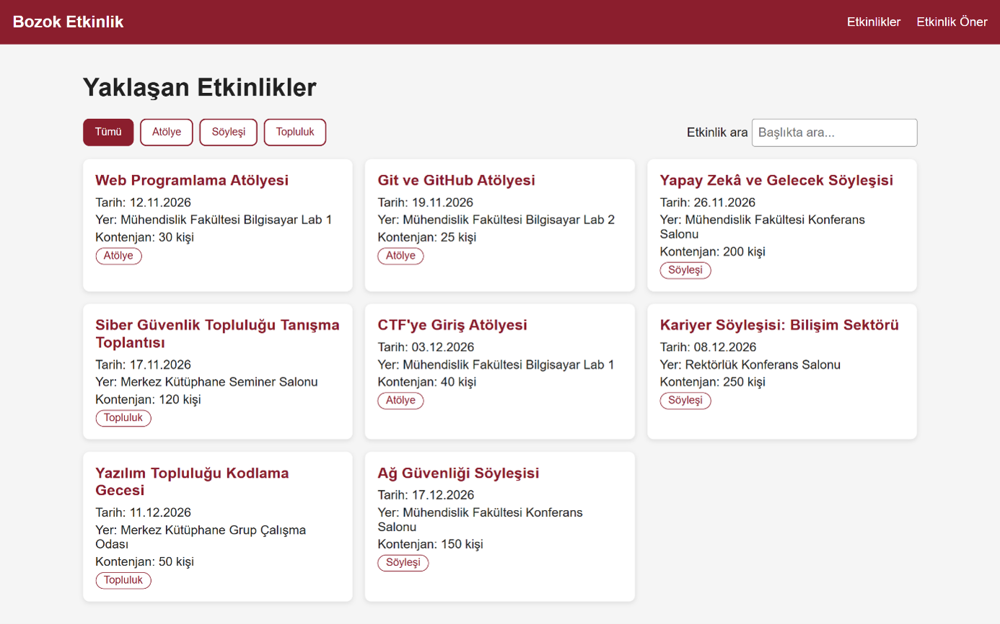

# Bozok Etkinlik Panosu

BMH231 Web Programlama dersinin 2. ödevi için hazırladığım kampüs etkinlik panosu. Etkinlikler, Node.js ile yazdığım küçük bir sunucunun JSON API'sinden fetch ile çekiliyor. Sayfada tür filtresi, başlıkta arama ve etkinlik öneri formu var. Sunucuda Express, ön yüzde framework ya da CSS kütüphanesi kullanılmadı.

## Kurulum ve çalıştırma

```
git clone https://github.com/cigdem-can/bmh231-odev2.git
cd bmh231-odev2
npm start
```

Sonra tarayıcıda http://localhost:3000 adresini açın. Dış paket olmadığı için `npm install` gerekmiyor. Windows PowerShell'de `npm` komutu izin hatası verirse `npm.cmd start` yazabilirsiniz.

## API uç noktaları

| Yöntem | Yol | Durum | Yanıt |
|---|---|---|---|
| GET | `/` ve `public/` altındaki dosyalar | 200 | HTML, CSS ya da JS dosyası |
| GET | `/api/etkinlikler` | 200 | Tüm etkinlikler (JSON) |
| GET | `/api/etkinlikler?tur=atolye` | 200 | Sadece o türdeki etkinlikler (JSON) |
| GET | `/api/etkinlikler/3` | 200 | Tek etkinlik (JSON) |
| GET | `/api/etkinlikler/999` | 404 | `{"hata": "Etkinlik bulunamadı"}` |
| GET | Bulunmayan diğer yollar | 404 | Düz metin |
| GET dışındaki yöntemler | Herhangi bir yol | 405 | Düz metin, `Allow: GET` başlığı |

## Ekran görüntüsü

